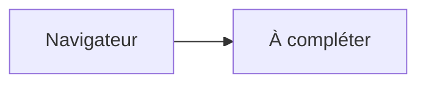

# Game Over — dossier d'architecture à compléter

Ce fichier est **votre unique livrable écrit**. Vous le remplissez dans `work/docs/`, pas dans `private/`. Ne supprimez aucune rubrique. Les parties « À compléter » doivent être remplacées par des réponses basées sur votre code et vos observations.

## 1. Architecture actuelle — diagramme Mermaid

Complétez le schéma **réel**, sans inventer de base PostgreSQL ni de service supplémentaire. Faites apparaître : Navigateur, Nginx/web, API, Controller, Service, Repository, domaine Commandes et Stock. Représentez la recherche `GET /api/games` et la commande `POST /api/checkout`.

- Trajet d'une recherche `GET /api/games` : À compléter.
- Trajet d'une commande `POST /api/checkout` : À compléter.

## 2. Couches logiques et services déployés

- À quoi servent Controller, Service et Repository ? Dans quel processus vivent-ils ? À compléter.
- Quels sont les rôles des conteneurs `web`, `api`, `inventory` ? À compléter.
- D'où viennent les données du Catalogue ? Où est stockée la quantité disponible des jeux ? Y a-t-il PostgreSQL ? À compléter.

## 3. Domaines métier et responsabilités

- Catalogue : une responsabilité, une règle, et le module qui la porte : À compléter.
- Commandes : une responsabilité, une règle, et le module qui la porte : À compléter.
- Stock : une responsabilité, une règle, et le service qui la porte : À compléter.
- Qui valide le panier ? Qui fixe les prix officiels ? Qui décide si une réservation est possible ? À compléter.

## 4. MVC, MVVM et MVT

- Quel rôle du Controller rappelle MVC côté API ? À compléter.
- Que fait le ViewModel indépendant de React, et quel est son intérêt ? À compléter.
- Pourquoi ne pas réécrire la boutique en MVT ? À compléter.

## 5. Scalabilité : vos mesures réelles (mission 5)

Utilisez le **même poste**, le même bouton de simulation et **48 requêtes**. Le préchauffage du test est **hors mesure**. Relevez « avant » après les missions 1 à 4, **avant de modifier `work/api/cache.mjs`**. Relevez « après » une fois le cache corrigé et l'API redémarrée.

| Mesure | Avant cache | Après cache |
| --- | --- | --- |
| p95 (ms) | À compléter | À compléter |
| Débit (requêtes/seconde) | À compléter | À compléter |

- Ce que vous observez en comparant les résultats : À compléter.
- Un bénéfice du cache et une limite d'un cache mémoire local : À compléter.
- Si trois API sont derrière un load-balancer, comment se comportent leurs caches respectifs ? À compléter.
- Une autre option de mise à l'échelle, avec son coût ou son compromis : À compléter.

## 6. Décision d'architecture pour une V2

- Pour Catalogue + Commandes : **monolithe modulaire ou microservices** ? Votre choix et sa justification : À compléter.
- Pour Stock : **garder un service séparé ou le réintégrer** ? Votre choix et sa justification : À compléter.
- Au moins **un avantage**, **un coût ou risque** et **une alternative écartée** pour les décisions retenues : À compléter.

Relisez vos réponses. Elles doivent décrire ce que fait **vraiment** l'application et les modifications réalisées dans `work/`.
